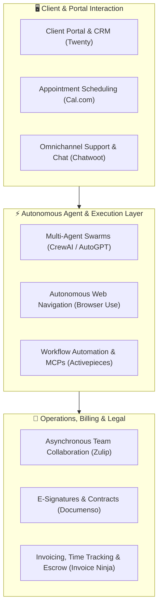

# 🤖 Awesome Virtual Assistant Marketplace

### A Curated Directory of SaaS Talent Platforms, Autonomous AI Agents & Remote Work Infrastructure

  
  
  
  
  
  

  <strong>Find top-tier virtual assistants, compare enterprise VA staffing platforms, and deploy open-source autonomous agent marketplaces.</strong>

---

## 📑 Table of Contents

- [🌟 Overview & SEO Taxonomy](#-overview--seo-taxonomy)
- [📊 Sector Overview & Market Dynamics](#-sector-overview--market-dynamics)
- [🏢 SaaS & Hosted Virtual Assistant Marketplaces](#-saas--hosted-virtual-assistant-marketplaces)
- [💻 Open-Source Repositories & Agent Frameworks](#-open-source-repositories--agent-frameworks)
- [🛠️ Architecture: Building a Self-Hosted VA Stack](#-architecture-building-a-self-hosted-va-stack)
- [🤝 How to Contribute](#-how-to-contribute)
- [⭐ Star History](#-star-history)
- [💖 Support & Community](#-support--community)
- [📜 License & Disclaimer](#-license--disclaimer)

---

## 🌟 Overview & SEO Taxonomy

Welcome to the **Awesome Virtual Assistant Marketplace** directory — the premier index tracking top **SaaS talent marketplaces**, **managed executive assistant services**, and **open-source autonomous AI agent architectures**. 

Whether you are looking to **hire freelance virtual assistants**, engage **pre-vetted executive administrative talent**, or architect your own **self-hosted AI task marketplace**, this repository curates verified pricing tiers, free tier specifications, and open-source GitHub alternatives sorted by community adoption.

### 🔍 Key Search Intent & Categories
- **Virtual Assistant Marketplaces**: Platforms connecting founders and operations teams with administrative, technical, and marketing VAs.
- **Managed & Done-For-You Agencies**: High-touch talent matching with dedicated client success oversight, backup assistants, and payroll handling.
- **Freelance & Micro-Task Portals**: Escrow-backed talent bidding and task-based gig economies.
- **Open-Source AI Agent Marketplaces**: Developer-first frameworks for assembling multi-agent swarms, autonomous browser agents, and decentralized task protocols.
- **Remote Work Operations Infrastructure**: Self-hosted chat, scheduling, e-signatures, invoicing, and client portals tailored for virtual assistant operations.

---

## 📊 Sector Overview & Market Dynamics

> 💡 **Market Size & Growth**: The global virtual assistant and outsourced freelancing market was valued at **$4.1 billion in 2024** and is projected to surpass **$14.8 billion by 2030**, expanding at a robust compound annual growth rate (CAGR) of **23.5%**. 

### ⚖️ Market Structure & Fragmentation
- **Bifurcated Barbell Structure**: The sector is **moderately fragmented** with a distinctive barbell distribution:
  - **Concentrated Commodity Platforms**: At the high-volume self-serve end, public tech giants (*Upwork*, *Fiverr*) command high market share through liquidity network effects and global escrow rails.
  - **Highly Fragmented Managed Agencies & BPOs**: In the middle-to-high tier, thousands of boutique agencies and regional staffing brokers (*Belay*, *Wing*, *Time etc*, Philippine BPOs) compete on vetting rigor, specialized domain training (executive assistance, bookkeeping, SDR, healthcare), and timezone alignment.
  - **Decentralized AI Agent Disruption**: Rapidly emerging open-source agent frameworks (*AutoGPT*, *Browser Use*, *CrewAI*, *Eliza*) are unbundling repetitive digital tasks, transforming traditional hourly VA staffing models into blended **human-in-the-loop (HITL)** autonomous workflows.

---

## 🏢 SaaS & Hosted Virtual Assistant Marketplaces

The following table provides a comprehensive comparison of leading SaaS and hosted virtual assistant platforms, sorted by **Company Size / Valuation / Revenue (Descending)**.

| 🏢 Platform | 📈 Valuation / Revenue (Company Size) | 💵 Specific Starting Pricing | 🎁 Specific Free Tier / Trial Limit | 🎯 Key Focus & Capabilities |
| :--- | :--- | :--- | :--- | :--- |
| **[Upwork](https://www.upwork.com/)** | **~$2.0B Market Cap** ($768M ARR, NASDAQ: UPWK) | **5% client service fee** per contract payment (+ $4.95–$9.95 one-time contract initiation fee); Freelancer VA rates start from **$15.00/hr** | **Free forever client account**: Post unlimited jobs, search global talent catalog, receive proposals, and use collaborative workspaces; pay only 5% when hiring | Global self-serve freelance marketplace with milestone/hourly escrow, time tracking with screenshots, and direct contracting |
| **[Fiverr](https://www.fiverr.com/)** | **~$950M Market Cap** ($385M ARR, NYSE: FVRR) | **$5.00/gig** entry pricing; **5.5% buyer fee** (+ $3.00 flat surcharge on orders below $75.00) | **Free forever client account**: Browse gig catalog, direct message sellers, save custom talent lists, and submit custom requests; pay only upon checkout | Gig-based task marketplace for fixed-scope micro-tasks, digital marketing deliverables, and vetted Fiverr Pro specialists |
| **[Belay](https://belaysolutions.com/)** | **~$75M Annual Revenue** (Private, Inc. 5000 regular) | **$1,480/month** starter package (30 dedicated hours/mo at ~$49.33/hr; full-time executive VAs scale to ~$3,400–$4,200/mo) | **Free 30-minute discovery consultation**: In-depth staffing assessment and custom talent matching plan (0 free trial work hours) | White-glove, U.S.-based executive administrative assistants, specialized bookkeepers, and social media managers |
| **[Time etc](https://www.timeetc.com/)** | **~$20M Annual Revenue** (Private) | **$390/month** starter tier (10 hours/mo at $39.00/hr; scaling to 60 hours/mo for $2,160 at $36.00/hr) | **Free 1-task trial**: Up to 1 hour of free virtual assistant work for qualified new business accounts + complimentary setup call | Subscription-based U.S. administrative assistants with multi-user team sharing, dedicated assistant match, and unused hour rollover |
| **[Outsource Accelerator](https://www.outsourceaccelerator.com/)** | **~$18M Est. Revenue** (3,000+ BPO partners) | **Free directory matching**; bespoke enterprise staffing brokerage & BPO advisory starts from **$1,500/placement** | **Free forever directory access**: Search 3,000+ verified BPO profiles, compare industry salary benchmarks, and request 3 free custom quote comparisons | Outsourcing marketplace and advisory platform bridging businesses with vetted Philippine and offshore BPO staffing providers |
| **[Wing Assistant](https://wingassistant.com/)** | **~$15M ARR** (Venture-backed, Y Combinator alumni) | **$699/month** part-time (80 hours/mo at ~$8.74/hr); **$999/month** full-time (160 hours/mo at ~$6.24/hr) | **Free 30-minute discovery call** + **7-day 100% money-back guarantee** on initial plan (0 free forever monthly hours) | Dedicated offshore bilingual virtual assistants with dedicated Customer Success Manager, video training library, and Slack/Teams app |
| **[FreeUp](https://freeup.net/)** | **~$12M Gross Volume** (Acquired) | **$10.00/hr** entry-level rates up to **$75.00+/hr** for experts; **0% client platform fees** (15% platform markup included in freelancer rate) | **Free forever client membership**: Post unlimited roles, receive 1-on-1 hand-picked candidate matches within 24 hours; pay only for logged billable hours | Pre-vetted freelance marketplace catering to ecommerce, digital marketing, Amazon store operators, and scaling startups |
| **[Wishup](https://www.wishup.co/)** | **~$10M Annual Revenue** (Series A funded) | **$999/month** half-time plan (4 hrs/day, 80 hrs/mo at ~$12.49/hr); **$1,799/month** full-time (8 hrs/day, 160 hrs/mo at ~$11.24/hr) | **7-day risk-free trial**: Includes instant replacement guarantee, complimentary onboarding consultation, and initial candidate interviews | Top 0.1% pre-vetted remote assistants trained across 70+ business tools, featuring instant 20-minute emergency backup replacement |
| **[OnlineJobs.ph](https://www.onlinejobs.ph/)** | **~$8M Annual Revenue** (Bootstrapped) | **$69/month Pro** plan (or $99/mo Premium) to direct message & hire candidates; **0% ongoing commission** on worker payroll | **Free forever basic membership**: Post up to 3 job listings and review applicant profiles/resumes; paid upgrade required to message candidates | Direct-hire job board and database for Filipino remote professionals with direct employer payroll and zero ongoing platform cuts |
| **[Fancy Hands](https://www.fancyhands.com/)** | **~$4M Annual Revenue** (Private) | **$17.99/month** Small plan (3 requests/mo at ~$6.00/request); **$34.99/month** Medium (5 requests/mo); **$149.99/month** (30 requests/mo) | **Free 3-day promotional trial** or **$10 discount** on first month; unused task requests roll over indefinitely with active subscription | On-demand U.S. micro-task assistant service covering phone calls, reservations, scheduling, and repetitive administrative chores |

---

## 💻 Open-Source Repositories & Agent Frameworks

Open-source virtual assistant platforms, autonomous agent swarms, and remote operational tools. Sorted by **GitHub Stars_Count (Descending)**.

- **[AutoGPT](https://github.com/Significant-Gravitas/AutoGPT)**   
  *The flagship open-source autonomous AI agent platform.* Enables goal-driven virtual assistants capable of recursive task execution, web scraping, file manipulation, and long-term memory retrieval to automate complex administrative workflows.

- **[Browser Use](https://github.com/browser-use/browser-use)**   
  *Make websites accessible for AI agents.* An open-source autonomous web browsing virtual assistant that clicks, navigates, extracts structured data, and completes web forms exactly like a human remote assistant.

- **[CrewAI](https://github.com/crewAIInc/crewAI)**   
  *Framework for orchestrating autonomous AI agent crews.* Enables developers to define specialized virtual assistant teams (e.g., Researcher, Copywriter, Executive Assistant) that collaborate to plan, delegate, and execute complex business goals.

- **[Twenty](https://github.com/twentyhq/twenty)**   
  *Open-source CRM designed for modern teams and AI.* Provides full customer data ownership, pipeline visibility, and automated tasks for virtual assistants managing client relationships, lead scoring, and outreach.

- **[Cal.com](https://github.com/calcom/cal.diy)**   
  *Open-source scheduling infrastructure for everyone.* Self-hosted scheduling platform that enables executive assistants to orchestrate calendars, book client appointments, accept payments, and automate meeting workflows with zero vendor lock-in.

- **[Chatwoot](https://github.com/chatwoot/chatwoot)**   
  *Open-source customer communication platform and omnichannel desk.* Equips virtual support assistants with live chat, email ticketing, WhatsApp, and social media inboxes with rich AI assistant integrations.

- **[Zulip](https://github.com/zulip/zulip)**   
  *Open-source, topic-based asynchronous team chat.* Built for remote collaboration with 130+ integrations, full markdown support, LDAP/SAML authentication, and organized thread hierarchies ideal for distributed VA agencies.

- **[Activepieces](https://github.com/activepieces/activepieces)**   
  *Open-source workflow automation and MCP server hub for AI agents.* An open alternative to Zapier, providing 400+ connectors and visual orchestration for virtual assistants to automate repetitive data entry, CRM syncing, and reporting.

- **[ElizaOS](https://github.com/elizaOS/eliza)**   
  *Open-source agentic operating system.* Lightweight, flexible framework for deploying autonomous multi-agent virtual assistants across Discord, Twitter/X, Telegram, and REST APIs with extensible document retrieval and memory.

- **[Documenso](https://github.com/documenso/documenso)**   
  *The open-source DocuSign alternative.* Self-hosted digital signature platform allowing virtual assistant agencies and clients to execute legally compliant service agreements, contractor NDAs, and onboarding paperwork.

- **[Invoice Ninja](https://github.com/invoiceninja/invoiceninja)**   
  *Open-source billing, invoicing, and time-tracking suite.* Built with Laravel and Flutter, providing freelance virtual assistants and agencies with automated recurring invoices, task time tracking, project milestones, and client portals.

- **[LibreSign](https://github.com/LibreSign/libresign)**   
  *Open-source digital signature platform with Nextcloud integration.* AGPL-3.0 licensed digital signature solution recognized as a Digital Public Good, keeping all contractual VA documents under complete sovereign data control.

- **[OpenMule](https://github.com/James4Ever0/openmule)**   
  *Decentralized AI task marketplace.* Connects human buyers with autonomous AI agents. Built with a Rust (Axum) backend and Vue 3 frontend, featuring task bidding, order management, payment processing, and WebSocket messaging.

- **[Ndizi](https://github.com/mjrich/ndizi)**   
  *Client and project management system with Stripe billing.* Features ticket visibility, time tracking with custom billing rates, multi-currency invoice generation, and Abilities API support for AI agent integrations.

- **[ComradeAI](https://github.com/SergeiKarulin/ComradeAI)**   
  *Multi-agent collaborative orchestration protocol.* Unifies models from Anthropic, OpenAI, Meta, and Google into collaborative virtual assistant networks using digital currency settlement and standard communication protocols.

- **[Myelin](https://github.com/Tiag0ss/myelin)**   
  *Open-source project and client management workspace.* Docker-deployed Next.js/Express stack providing client ticketing portals, expense tracking with approval workflows, and an embedded AI assistant.

- **[Special Agents](https://github.com/jinnks/special-agents)**   
  *AI agent marketplace with ethical review and `.sagent` packaging.* Python/Flask marketplace enabling developers to publish, monetize, and chat with specialized AI agents using Claude APIs and standardized package distribution.

---

## 🛠️ Architecture: Building a Self-Hosted VA Stack

For founders, engineering teams, and agencies looking to eliminate intermediary commission fees and maintain sovereign data privacy, open-source projects can be composed into a production-grade virtual assistant infrastructure:

- **Client Intake & Scheduling**: Use [Twenty](https://github.com/twentyhq/twenty) for client relationship tracking and [Cal.com](https://github.com/calcom/cal.diy) for automated scheduling.
- **Task Automation**: Deploy [Browser Use](https://github.com/browser-use/browser-use) and [Activepieces](https://github.com/activepieces/activepieces) to automate repetitive administrative browser tasks and web hooks.
- **Team Coordination & Security**: Host [Zulip](https://github.com/zulip/zulip) for async communication, [Documenso](https://github.com/documenso/documenso) for NDA execution, and [Invoice Ninja](https://github.com/invoiceninja/invoiceninja) for milestone billing.

---

## 🤝 How to Contribute

We welcome contributions from founders, virtual assistants, agency managers, and open-source developers!

1. 🍴 **Fork the repository** to your GitHub account.
2. 🌿 **Create a new branch** (`git checkout -b feature/add-new-platform`).
3. 📝 **Add or update an entry**:
   - For **SaaS platforms**, ensure the entry contains exact starting pricing, verified free tier limits, and verifiable revenue/valuation data.
   - For **Open-Source projects**, include a valid GitHub repository with the social Stars_Badge link (``).
4. 📬 **Submit a Pull Request** with a clear explanation and official citations.

---

## ⭐ Star History

---

## 💖 Support & Community

Thank you for utilizing and supporting **Awesome-Virtual-Assistant-Marketplace**! If this curated repository helps you hire talent, discover new operational tools, or build AI assistant systems, please consider supporting the project:

- ⭐ **Star this repository** to improve visibility and help other teams discover it.
- 🍴 **Fork and contribute** your favorite platforms, agency recommendations, and open-source stacks.
- 📢 **Share with your network** on LinkedIn, X/Twitter, Discord, and founder communities.
- ☕ **Sponsor the maintainer**: Support continuous research and directory curation via the [GitHub Sponsor Dashboard](https://github.com/sponsors/ishandutta2007).

---

## 📜 License & Disclaimer

- **License**: Released under the [MIT License](LICENSE).
- **Disclaimer**: This directory is an independent, community-curated research list and does not constitute formal endorsement. All virtual assistant contracts and platform usage must adhere to applicable regional employment laws, contractor classification standards, and data protection regulations (GDPR, CCPA, HIPAA).
